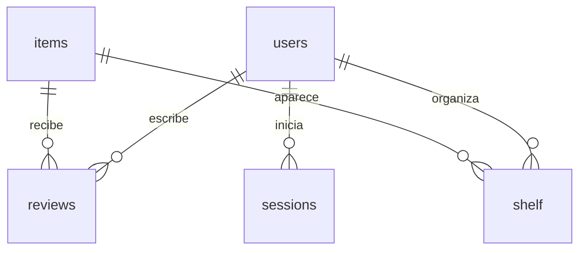

# Modelo de datos

El esquema implementado está en `src/database/schema.sql`. Se usa SQLite con claves foráneas activadas. El fichero se guarda fuera de `public/` y se excluye de Git.

## Tablas

| Tabla      | Campos                                                                                | Restricciones                                             |
| ---------- | ------------------------------------------------------------------------------------- | --------------------------------------------------------- |
| `users`    | id, username, email, password_hash, role, created_at                                  | Correo único sin distinguir mayúsculas; rol user o admin  |
| `items`    | id, title, type, creator, year, description, minutes, session_label, mood, created_at | Cuatro formatos; cuatro planes; minutos de 5 a 600        |
| `reviews`  | id, user_id, item_id, rating, comment, spoiler, created_at, updated_at                | Nota de 1 a 5; UNIQUE(user_id, item_id)                   |
| `shelf`    | user_id, item_id, status, updated_at                                                  | Clave primaria compuesta; tres estados                    |
| `sessions` | token_hash, user_id, csrf_token, expires_at                                           | Hash del token como clave; caducidad Unix en milisegundos |

Los identificadores son enteros. Las fechas de creación y edición usan ISO 8601 en UTC. Las contraseñas se derivan con scrypt: una sal aleatoria de 16 bytes y una clave de 64 bytes. Se almacena `sal:clave` en hexadecimal.

| Campo           | Valores                         |
| --------------- | ------------------------------- |
| items.type      | movie, book, series, game       |
| items.mood      | pausa, curioso, ligero, intenso |
| shelf.status    | pending, in_progress, finished  |
| reviews.spoiler | 0, 1                            |

`minutes` expresa una sesión orientativa y `session_label` explica qué incluye. No representa el tiempo total de una novela o videojuego.

## Relaciones

Reseñar y guardar son operaciones independientes. Escribir una reseña no modifica el estado en la estantería.

Las claves foráneas usan `ON DELETE CASCADE`. Borrar una propuesta elimina sus reseñas y guardados; la interfaz pide confirmación. No existe una operación pública de borrado de usuarios.

La media se calcula con `AVG(reviews.rating)` y el contador con `COUNT`. Sin reseñas, la media es `null` y el contador `0`.

## Sesiones

El navegador recibe un token aleatorio de 32 bytes en una cookie HttpOnly y SameSite=Lax. SQLite guarda su hash SHA-256, un token CSRF independiente y una caducidad a siete días. El logout borra la fila y limpia la cookie. Las sesiones caducadas se limpian al abrir la base de datos y al crear una sesión nueva.

## Permisos

| Operación                    | Visitante | Usuario           | Administrador     |
| ---------------------------- | --------- | ----------------- | ----------------- |
| Consultar catálogo y reseñas | Sí        | Sí                | Sí                |
| Gestionar estantería         | No        | Solo la propia    | Solo la propia    |
| Crear reseña                 | No        | Una por propuesta | Una por propuesta |
| Editar reseña                | No        | Solo la propia    | Solo la propia    |
| Eliminar reseña              | No        | Solo la propia    | Cualquiera        |
| Gestionar catálogo           | No        | No                | Sí                |
| Cambiar roles desde la API   | No        | No                | No                |

El administrador se prepara mediante un script local. Ocultar botones no sustituye la comprobación del servidor.

## Inicialización

El primer arranque crea las tablas y carga las 16 fichas de `src/database/seed.js`. `PRAGMA user_version=1` evita repetir esa carga cuando se reinicia un catálogo vacío. Un cambio futuro de esquema necesitará una migración explícita; `CREATE TABLE IF NOT EXISTS` no actualiza tablas existentes.

Se usa WAL y una espera de cinco segundos para bloqueos breves. La configuración está pensada para una instancia del servidor y la escala de la práctica.
