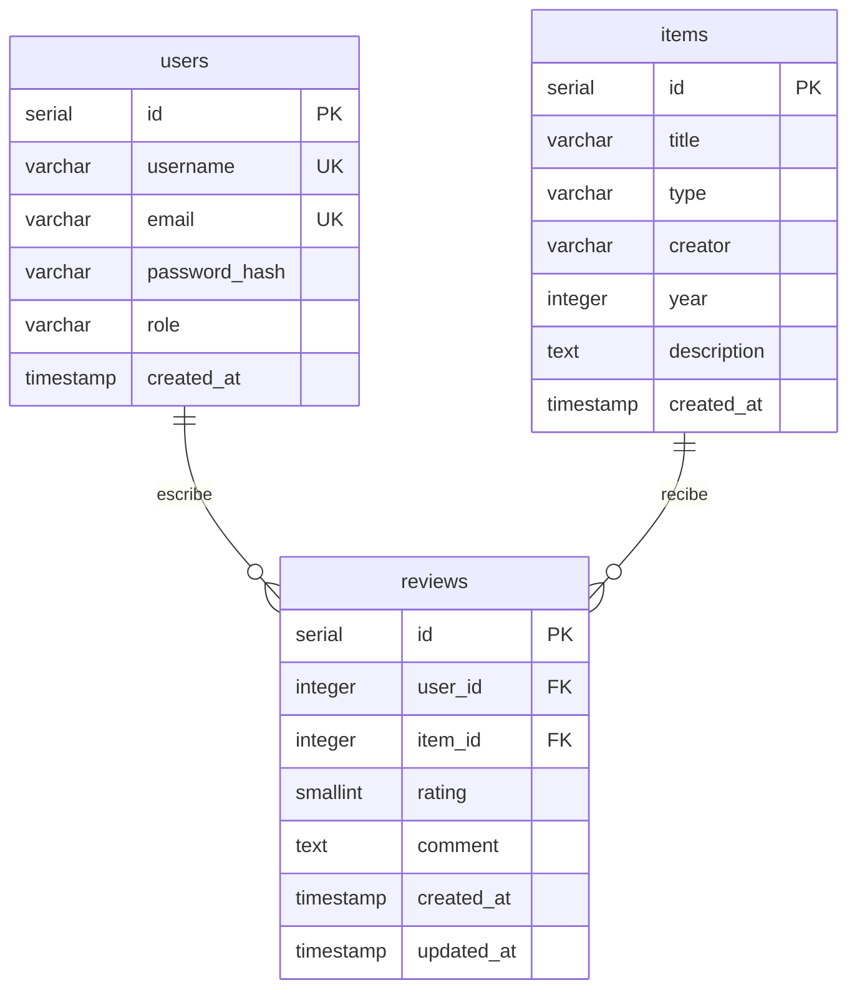

# Modelo de datos

El modelo previsto usa PostgreSQL con tres tablas relacionadas: usuarios, elementos del catálogo y reseñas. Su implementación en la base de datos está pendiente.

## Tablas

### users

| Campo | Tipo | Notas |
|---|---|---|
| id | serial, clave primaria | |
| username | varchar(30) | único, obligatorio |
| email | varchar(255) | único, obligatorio |
| password_hash | varchar(100) | hash de la contraseña, nunca la contraseña en claro |
| role | varchar(10) | `user` o `admin`; por defecto `user` |
| created_at | timestamp | por defecto, la fecha actual |

### items

| Campo | Tipo | Notas |
|---|---|---|
| id | serial, clave primaria | |
| title | varchar(200) | obligatorio |
| type | varchar(20) | `movie`, `book`, `series`, `game` u `other` |
| creator | varchar(200) | autor, director o estudio; obligatorio |
| year | integer | opcional |
| description | text | opcional |
| created_at | timestamp | por defecto, la fecha actual |

### reviews

| Campo | Tipo | Notas |
|---|---|---|
| id | serial, clave primaria | |
| user_id | integer, clave foránea a users.id | borrado en cascada |
| item_id | integer, clave foránea a items.id | borrado en cascada |
| rating | smallint | entre 1 y 5 |
| comment | text | obligatorio |
| created_at | timestamp | fecha de creación |
| updated_at | timestamp | fecha de la última edición |

## Relaciones

- Un usuario escribe muchas reseñas (relación 1 a N).
- Un elemento del catálogo recibe muchas reseñas (relación 1 a N).
- Restricción `UNIQUE (user_id, item_id)`: un usuario solo puede reseñar una vez cada elemento.
- Al borrar un usuario o un elemento, se borran también sus reseñas.

## Diagrama

La restricción de unicidad de `reviews` corresponde a la pareja `(user_id, item_id)`.

## Roles y permisos

| Rol | Permisos |
|---|---|
| Visitante (sin sesión) | Ver el catálogo y leer las reseñas |
| user | Lo anterior, y escribir, editar y borrar sus propias reseñas |
| admin | Lo anterior, y gestionar el catálogo, borrar cualquier reseña y cambiar roles |
